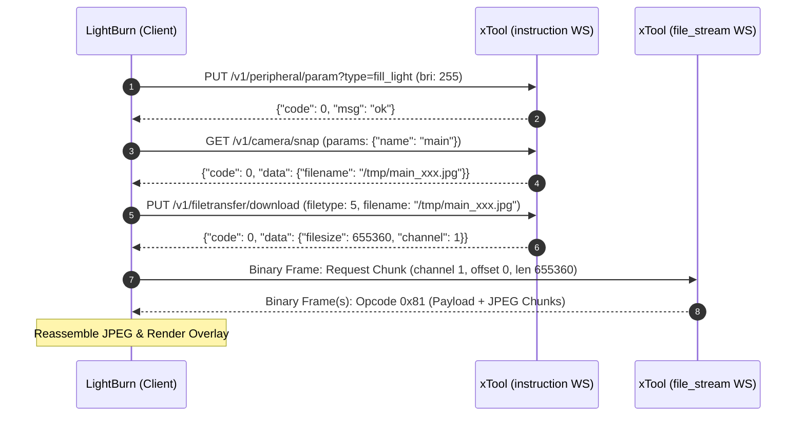

# Technical Specification: xTool F2 Ultra & F-Series Hardware & Camera Protocol
**Prepared for the LightBurn Software Development & Device Engineering Team**  
**Document Version:** 1.0  
**Date:** October 2026  
**Target Hardware:** xTool F2 Ultra UV (`GS009-CLASS-4`), xTool F2 Ultra Dual (`GS004-CLASS-4`), xTool F2 Ultra Single (`GS007-CLASS-4`), xTool F1 Ultra (`GS003` / `GS002`)

---

## 1. Executive Summary

The **xTool F2 Ultra** and **F1 Ultra** are dual-laser galvo systems (UV / MOPA Fiber / Diode) equipped with:
1. High-resolution overhead dual-camera optical modules (`main` workspace bed camera and `deep` macro autofocus camera).
2. Software-controlled high-output front and rear LED chamber fill lights.
3. Motorized Z-axis table/laser head with automated distance-sensing autofocus.

Currently, LightBurn users cannot utilize the built-in camera or autofocus features because xTool does **not** expose standard video protocols (no RTSP, no ONVIF, no standard HTTP/MJPEG port, and no USB UVC device descriptor). Instead, the machine runs an embedded Linux/RTOS controller that exposes a single, proprietary **TLS WebSocket service on TCP port 28900**.

This document details the reverse-engineered wire protocol, packet framing, authentication handshake, lighting commands, binary transfer protocol, and Z-focus control endpoints so that the LightBurn team can implement native driver and camera support directly within LightBurn.

---

## 2. Hardware Architecture & Network Transport

### 2.1 Network Discovery & Open Ports
- **Transport:** Ethernet (100/1000 Mbps) or 2.4/5 GHz Wi-Fi.
- **Port:** **`TCP 28900`** is the **only** open port on the device. All HTTP (80/8080), RTSP (554), and Telnet/SSH ports are closed.
- **TLS/SSL Encryption:** All communication is secured via TLS 1.2 / 1.3 with a self-signed certificate issued to:
  - `CN = Makeblock Europe B.V.`
  - LightBurn client connection must disable strict CA peer verification (`QSslSocket::VerifyNone` or equivalent).

### 2.2 Dual-Channel WebSocket Architecture
The machine requires **two separate concurrent WebSocket connections** sharing the same `sessionID`:

| WebSocket Role | URL Query Parameter | Purpose |
| :--- | :--- | :--- |
| **`instruction`** | `wss://<IP>:28900/api/v1/network?role=instruction&sessionID=<UUID>` | JSON-RPC control plane: parity authentication, camera snap requests, light control, and autofocus commands. |
| **`file_stream`** | `wss://<IP>:28900/api/v1/network?role=file_stream&sessionID=<UUID>` | Binary data plane: high-speed chunked transport for captured snapshot JPEGs, firmware updates, and calibration profiles. |

---

## 3. Session Initialization & "Parity" Handshake

Before any camera, light, or motion commands are honored, the client must authenticate over the `instruction` WebSocket.

### 3.1 Handshake Request
```json
{
  "type": "request",
  "method": "GET",
  "url": "/v1/user/parity",
  "transactionId": 1,
  "params": {},
  "data": {
    "userID": "mk-guest",
    "userKey": "bWFrZWJsb2NrLXh0b29s",
    "timezone": "Europe/Berlin"
  }
}
```
> [!NOTE]
> `userKey` is the Base64 representation of the ASCII string `"makeblock-xtool"` (`bWFrZWJsb2NrLXh0b29s`).

### 3.2 Handshake Response
```json
{
  "type": "response",
  "method": "GET",
  "url": "/v1/user/parity",
  "transactionId": 1,
  "code": 0,
  "msg": "ok",
  "data": {
    "deviceCode": "GS009-CLASS-4",
    "mac": "XX:XX:XX:XX:XX:XX",
    "version": "v1.2.x"
  }
}
```
If `code == 0`, the session is authenticated and operational.

---

## 4. Chamber Fill Light Subsystem

The F2 Ultra camera sensor has a fixed exposure curve tuned specifically to its internal high-output LED arrays. **Without turning the fill lights on, captured images are nearly pitch black.** LightBurn must control the fill lights in tandem with camera operations.

### 4.1 Set Brightness Command
- **Socket:** `instruction`
- **Endpoint:** `PUT /v1/peripheral/param?type=fill_light`

```json
{
  "type": "request",
  "method": "PUT",
  "url": "/v1/peripheral/param?type=fill_light",
  "transactionId": 2,
  "params": {
    "type": "fill_light"
  },
  "data": {
    "action": "set_bri",
    "front": 255,
    "back": 255
  }
}
```

### 4.2 Parameter Specifications
- `front`: Integer `0` to `255` (Front LED bar brightness).
- `back`: Integer `0` to `255` (Rear LED bar brightness).
- `0` = Complete blackout.
- `255` = Maximum illumination (~6,500K neutral daylight white).
- Recommended setting for camera capture: `front: 255, back: 255`.

---

## 5. Camera Capture Pipeline

The machine contains two physical camera sensors:
- `"main"`: Wide-angle overhead camera capturing the entire 220 × 220 mm bed area (used for workspace overlays).
- `"deep"`: Narrow macro/telephoto lens used for high-precision local autofocus and surface inspection.



### 5.1 Trigger Snapshot
- **Endpoint:** `GET /v1/camera/snap`
- **Method:** `GET`
```json
{
  "type": "request",
  "method": "GET",
  "url": "/v1/camera/snap",
  "transactionId": 3,
  "params": {
    "name": "main"
  },
  "data": {}
}
```
**Response:**
```json
{
  "code": 0,
  "transactionId": 3,
  "data": {
    "filename": "/tmp/main_20261020_114328.jpg"
  }
}
```

### 5.2 Initiate File Download
- **Endpoint:** `PUT /v1/filetransfer/download`
```json
{
  "type": "request",
  "method": "PUT",
  "url": "/v1/filetransfer/download",
  "transactionId": 4,
  "params": {},
  "data": {
    "filetype": 5,
    "filename": "/tmp/main_20261020_114328.jpg",
    "digesttype": 1,
    "channel": 1,
    "packetsize": 1048576
  }
}
```
**Response:**
```json
{
  "code": 0,
  "transactionId": 4,
  "data": {
    "filesize": 655360,
    "channel": 1,
    "filetype": 5
  }
}
```

---

## 6. Binary Packet Framing & CRC-16 ARC Specification

Binary transfers over the `file_stream` socket use a custom 10-byte header with a two-stage CRC verification.

### 6.1 10-Byte Header Structure

```text
 0                   1                   2                   3
 0 1 2 3 4 5 6 7 8 9 0 1 2 3 4 5 6 7 8 9 0 1 2 3 4 5 6 7 8 9 0 1
+-+-+-+-+-+-+-+-+-+-+-+-+-+-+-+-+-+-+-+-+-+-+-+-+-+-+-+-+-+-+-+-+
|       Magic 0xBA 0xBE         |          Payload Length       |
+-+-+-+-+-+-+-+-+-+-+-+-+-+-+-+-+-+-+-+-+-+-+-+-+-+-+-+-+-+-+-+-+
| (Len Cont.)   | Proto / Flags |        Payload CRC-16         |
+-+-+-+-+-+-+-+-+-+-+-+-+-+-+-+-+-+-+-+-+-+-+-+-+-+-+-+-+-+-+-+-+
|         Header CRC-16         |   Payload Data starts here... |
+-+-+-+-+-+-+-+-+-+-+-+-+-+-+-+-+-+-+-+-+-+-+-+-+-+-+-+-+-+-+-+-+
```

| Byte Offset | Field | Type | Description |
| :--- | :--- | :--- | :--- |
| `0..1` | **Magic** | `uint16_t` (BE) | Fixed framing identifier: `0xBA 0xBE` |
| `2..4` | **Payload Length** | `uint24_t` (BE) | 24-bit big-endian payload length (excluding this 10-byte header) |
| `5` | **Protocol / Flags**| `uint8_t` | `(protocolType & 0x7F) \| (cal_crc ? 0 : 0x80)`. Default `0x04` |
| `6..7` | **Payload CRC-16** | `uint16_t` (BE) | CRC-16/ARC checksum computed over the entire payload data |
| `8..9` | **Header CRC-16** | `uint16_t` (BE) | CRC-16/ARC checksum computed over bytes `0..7` of this header |

### 6.2 CRC-16 ARC Algorithm Details
- **Polynomial:** `0x8005` ($x^{16} + x^{15} + x^2 + 1$)
- **Initial Value:** `0x0000`
- **Reflected Input:** `True`
- **Reflected Output:** `True`
- **XOR Out:** `0x0000`

#### Precomputed C++ Lookup Table:
```cpp
static const uint16_t CRC16_ARC_TABLE[256] = {
    0x0000, 0xC0C1, 0xC181, 0x0140, 0xC301, 0x03C0, 0x0280, 0xC241,
    0xC601, 0x06C0, 0x0780, 0xC741, 0x0500, 0xC5C1, 0xC481, 0x0440,
    0xCC01, 0x0CC0, 0x0D80, 0xCD41, 0x0F00, 0xCFC1, 0xCE81, 0x0E40,
    0x0A00, 0xCAC1, 0xCB81, 0x0B40, 0xC901, 0x09C0, 0x0880, 0xC841,
    0xD801, 0x18C0, 0x1980, 0xD941, 0x1B00, 0xDBC1, 0xDA81, 0x1A40,
    0x1E00, 0xDEC1, 0xDF81, 0x1F40, 0xDD01, 0x1DC0, 0x1C80, 0xDC41,
    0x1400, 0xD4C1, 0xD581, 0x1540, 0xD701, 0x17C0, 0x1680, 0xD641,
    0xD201, 0x12C0, 0x1380, 0xD341, 0x1100, 0xD1C1, 0xD081, 0x1040,
    0xF001, 0x30C0, 0x3180, 0xF141, 0x3300, 0xF3C1, 0xF281, 0x3240,
    0x3600, 0xF6C1, 0xF781, 0x3740, 0xF501, 0x35C0, 0x3480, 0xF441,
    0x3C00, 0xFCC1, 0xFD81, 0x3D40, 0xFF01, 0x3FC0, 0x3E80, 0xFE41,
    0xFA01, 0x3AC0, 0x3B80, 0xFB41, 0x3900, 0xF9C1, 0xF881, 0x3840,
    0x2800, 0xE8C1, 0xE981, 0x2940, 0xEB01, 0x2BC0, 0x2A80, 0xEA41,
    0xEE01, 0x2EC0, 0x2F80, 0xEF41, 0x2D00, 0xEDC1, 0xEC81, 0x2C40,
    0xE401, 0x24C0, 0x2580, 0xE541, 0x2700, 0xE7C1, 0xE681, 0x2640,
    0x2200, 0xE2C1, 0xE381, 0x2340, 0xE101, 0x21C0, 0x2080, 0xE041,
    0xA001, 0x60C0, 0x6180, 0xA141, 0x6300, 0xA3C1, 0xA281, 0x6240,
    0x6600, 0xA6C1, 0xA781, 0x6740, 0xA501, 0x65C0, 0x6480, 0xA441,
    0x6C00, 0xACC1, 0xAD81, 0x6D40, 0xAF01, 0x6FC0, 0x6E80, 0xAE41,
    0xAA01, 0x6AC0, 0x6B80, 0xAB41, 0x6900, 0xA9C1, 0xA881, 0x6840,
    0x7800, 0xB8C1, 0xB981, 0x7940, 0xBB01, 0x7BC0, 0x7A80, 0xBA41,
    0xBE01, 0x7EC0, 0x7F80, 0xBF41, 0x7D00, 0xBDC1, 0xBC81, 0x7C40,
    0xB401, 0x74C0, 0x7580, 0xB541, 0x7700, 0xB7C1, 0xB681, 0x7640,
    0x7200, 0xB2C1, 0xB381, 0x7340, 0xB101, 0x71C0, 0x7080, 0xB041,
    0x5000, 0x90C1, 0x9181, 0x5140, 0x9301, 0x53C0, 0x5280, 0x9241,
    0x9601, 0x56C0, 0x5780, 0x9741, 0x5500, 0x95C1, 0x9481, 0x5440,
    0x9C01, 0x5CC0, 0x5D80, 0x9D41, 0x5F00, 0x9FC1, 0x9E81, 0x5E40,
    0x5A00, 0x9AC1, 0x9B81, 0x5B40, 0x9901, 0x59C0, 0x5880, 0x9841,
    0x8801, 0x48C0, 0x4980, 0x8941, 0x4B00, 0x8BC1, 0x8A81, 0x4A40,
    0x4E00, 0x8EC1, 0x8F81, 0x4F40, 0x8D01, 0x4DC0, 0x4C80, 0x8C41,
    0x4400, 0x84C1, 0x8581, 0x4540, 0x8701, 0x47C0, 0x4680, 0x8641,
    0x8201, 0x42C0, 0x4380, 0x8341, 0x4100, 0x81C1, 0x8081, 0x4040
};

inline uint16_t compute_crc16(const uint8_t* data, size_t length, uint16_t init = 0) {
    uint16_t crc = init;
    for (size_t i = 0; i < length; ++i) {
        crc = CRC16_ARC_TABLE[(crc ^ data[i]) & 0xFF] ^ (crc >> 8);
    }
    return crc;
}
```

### 6.3 Requesting File Chunks (`file_stream`)
To request data for channel `1`:
- **Payload Bytes (11 bytes):**
  `[0x01, channel (1 byte), 5-byte offset (BE), 4-byte window_size (BE)]`
- Wrapped in the 10-byte header (total frame size = 21 bytes) and sent via binary WebSocket frame.

### 6.4 Receiving Chunks
The machine answers with packets where `payload[0] == 0x81` (Opcode 129 = `FILE_DATA`):
- `payload[0]`: `0x81` (Type)
- `payload[1]`: Channel number (e.g. `0x01`)
- `payload[2..6]`: 5-byte big-endian file offset
- `payload[7..N]`: Raw JPEG bytes corresponding to that chunk.

---

## 7. Motorized Z-Axis & Autofocus System

The F2 Ultra features a motorized vertical lift system for focusing the dual galvo beams onto the workpiece. All focus actions are executed via the `instruction` WebSocket.

### 7.1 Automated Focus Trigger (Autofocus)
Triggers the laser head's built-in optical distance sensor to measure workpiece height and auto-position the Z-axis:
- **Endpoint:** `POST /v1/laser-head/focus/control`
- **Method:** `POST`
```json
{
  "type": "request",
  "method": "POST",
  "url": "/v1/laser-head/focus/control",
  "transactionId": 10,
  "params": {},
  "data": {
    "action": "auto_start"
  }
}
```

### 7.2 Stop / Abort Autofocus
```json
{
  "type": "request",
  "method": "POST",
  "url": "/v1/laser-head/focus/control",
  "transactionId": 11,
  "params": {},
  "data": {
    "action": "auto_stop"
  }
}
```

### 7.3 Query Current Z-Height
Reads the current absolute focal height of the machine:
```json
{
  "type": "request",
  "method": "POST",
  "url": "/v1/laser-head/focus/control",
  "transactionId": 12,
  "params": {},
  "data": {
    "action": "coord"
  }
}
```
**Response:**
```json
{
  "code": 0,
  "transactionId": 12,
  "data": {
    "value": 24.50
  }
}
```

### 7.4 Manual Z-Axis Positioning (Goto Height)
Moves the laser focal plane to a specific height in millimeters (e.g. for material thickness offset or manual focusing):
```json
{
  "type": "request",
  "method": "POST",
  "url": "/v1/laser-head/focus/control",
  "transactionId": 13,
  "params": {},
  "data": {
    "action": "goTo",
    "z": 18.00,
    "stopFirst": 1,
    "autoHome": 1
  }
}
```
> [!IMPORTANT]
> The absolute physical travel range of the Z-axis is `0.0 mm` to `156.0 mm`. Moving beyond `156.0 mm` triggers an `AUTO_FOCUS_FAIL` software limit.

---

## 8. Factory Calibration & Optical Config Download

xTool stores the factory camera distortion matrix, homography, and lens intrinsics directly in the machine's onboard storage.

- **Config Query:** `GET /v1/device/configs` with `{"alias": "config", "type": "user", "kv": ["imgConfigGlobalIr"]}`.
- **Calibration File Download:** `PUT /v1/filetransfer/download` with `filetype: 3` pulls the raw factory calibration blob from the machine.
- Alternatively, LightBurn's native **Camera Lens Calibration (9-point fisheye pattern)** and **Camera Alignment (4-corner target burn)** work seamlessly on the captured `"main"` JPEG feed.

---

## 9. Proposed Native LightBurn Implementation Architecture

To integrate this natively into LightBurn without external bridges:

### 9.1 Driver Class: `XToolFSeriesDevice`
Create a new device profile inherited from LightBurn's network galvo device abstractions:
- **Connection Type:** Network IP / Port `28900`.
- **Protocol:** TLS WebSocket.
- **Controls Exposed in GUI:**
  - **Camera Control Tab:** "Update Overlay" automatically sequences:
    1. Turn lights to 100% (`front: 255, back: 255`).
    2. Snap image (`/v1/camera/snap`).
    3. Stream binary JPEG via `file_stream`.
    4. Restore fill lights to user's idle preference.
  - **Laser Tools / Console:**
    - "Autofocus" button triggering `/v1/laser-head/focus/control` (`auto_start`).
    - Z-Jog arrows moving Z-height via `action: "goTo"`.
    - Z-readout field bound to `action: "coord"`.

---

## 10. Self-Contained Verification Script (Python Reference)

The following minimal script (zero dependencies, Python stdlib only) demonstrates the complete handshake, fill light illumination, snapshot capture, and chunk reassembly:

```python
#!/usr/bin/env python3
import socket, ssl, struct, json, os, time

LASER_IP = "192.168.178.39"
PORT = 28900

# 1. Setup TLS Socket
ctx = ssl.create_default_context()
ctx.check_hostname = False
ctx.verify_mode = ssl.CERT_NONE

raw_s = socket.create_connection((LASER_IP, PORT), timeout=10)
ws_inst = ctx.wrap_socket(raw_s)

# Perform standard HTTP WebSocket Upgrade
req = (f"GET /api/v1/network?role=instruction&sessionID=lb-test HTTP/1.1\r\n"
       f"Host: {LASER_IP}:{PORT}\r\nUpgrade: websocket\r\nConnection: Upgrade\r\n"
       f"Sec-WebSocket-Key: dGhlIHNhbXBsZSBub25jZQ==\r\nSec-WebSocket-Version: 13\r\n\r\n")
ws_inst.sendall(req.encode())
while b"\r\n\r\n" not in ws_inst.recv(4096): pass

# Helper to send JSON-RPC
def send_cmd(tx_id, method, url, data={}, params={}):
    body = json.dumps({"type":"request","method":method,"url":url,"transactionId":tx_id,"params":params,"data":data})
    payload = body.encode()
    mask = os.urandom(4)
    frame = bytearray([0x81, 0x80 | len(payload)]) + mask + bytearray(b ^ mask[i%4] for i, b in enumerate(payload))
    ws_inst.sendall(frame)

# 2. Authenticate
send_cmd(1, "GET", "/v1/user/parity", {"userID":"mk-guest","userKey":"bWFrZWJsb2NrLXh0b29s","timezone":"UTC"})
print("Auth sent. Machine will respond with code: 0.")

# 3. Turn on fill lights to 100%
send_cmd(2, "PUT", "/v1/peripheral/param?type=fill_light", {"action":"set_bri","front":255,"back":255}, {"type":"fill_light"})
print("Fill lights set to 100%.")

# 4. Trigger Snap
send_cmd(3, "GET", "/v1/camera/snap", {}, {"name":"main"})
print("Snapshot triggered. Use file_stream to download JPEG.")
```

---

## 11. Summary & Actionable Recommendations

- **No New Protocols Required on Machine:** The xTool F2 Ultra already runs a robust, fast network API capable of sub-2-second snapshot delivery and precise autofocus.
- **Lighting is Mandatory:** Any camera implementation must trigger `set_bri` before snapping to prevent dark captures.
- **Direct Integration:** Adding this driver to LightBurn gives users instant, native access to workspace camera overlays, autofocus, and lighting without third-party middleware.
